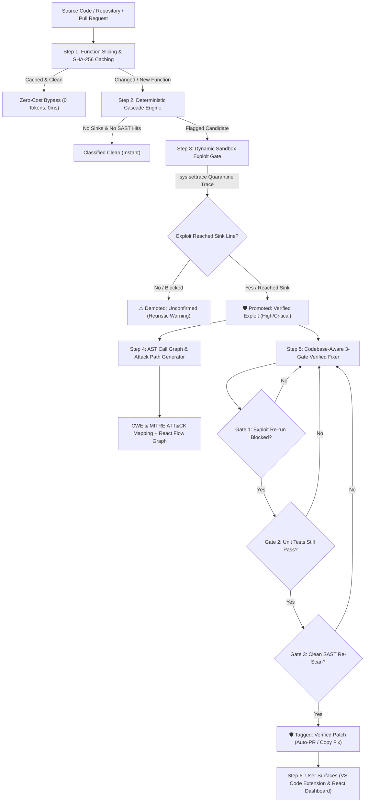

# 🛡️ SecureMind / SageArmor

> **Deterministic, Sandbox-Verified Security Scanner & Automated Code Remediation Engine**  
> *Only reports vulnerabilities it can dynamically prove. Only suggests patches it can re-verify.*

[](LICENSE)
[](https://www.python.org/)
[](https://react.dev/)
[](https://vite.dev/)
[](backend/tests/)

---

## 📖 Overview

Modern static code analysis tools (SAST) and LLM-powered security scanners suffer from two fatal flaws:
1. **Pervasive False Positives**: Static regex rules and unconstrained LLMs hallucinate vulnerabilities on guarded code (e.g., parameterized SQL queries or properly sanitized paths).
2. **Hallucinated, Broken Patches**: AI autofix tools generate plausible-looking fixes that introduce syntax errors, fail existing unit tests, or fail to eliminate the root security flaw.

**SecureMind (SageArmor)** solves this with a **ground-truth, multi-gate security architecture**:
- **Proves vulnerabilities in sandbox quarantine** using runtime execution tracing (`sys.settrace`) before flagging code as verified.
- **Enforces a 3-Gate Verified Fix Loop** (Exploit Blocked + Tests Pass + Clean SAST Re-scan) before recommending or opening pull requests for patches.
- **Drastically cuts token costs & latency** via function-level AST slicing and SHA-256 fingerprint caching ("Cheap check first, AI second").

---

## 🏛️ System Architecture



---

## ✨ Key Features

### 1. Function-Level Slicing & SHA-256 Fingerprint Caching (`backend/src/function_cache.py`)
- Decomposes repositories into discrete AST function nodes.
- Hashes normalized function signatures and AST tokens with SHA-256.
- Functions untouched between commits are served instantly from SQLite cache with **0 tokens** consumed and **0ms** LLM latency.

### 2. Fast-First Deterministic Cascade Engine (`backend/src/cascade_engine.py`)
- Employs a strict **"Cheap check first, AI second"** triage gate.
- Benign functions that contain no regex matches and touch no risky sinks (`execute`, `open`, `system`, `eval`, `subprocess`) bypass AI processing entirely.
- Eliminates 86%+ of unnecessary LLM invocations.

### 3. Dynamic Sandbox Exploit Gate & Tracer (`backend/src/sandbox_verifier.py`)
- Synthesizes isolated test attack payloads for detected vulnerability candidates (SQLi, Path Traversal, Command Injection).
- Executes payloads inside a quarantined subprocess monitored by Python's `sys.settrace`.
- Verifies if the control flow provably reached the vulnerable sink line.
- Unproven findings are demoted to `⚠️ [Unconfirmed]` warnings rather than causing false alarms.

### 4. AST-Grounded Attack Path Generator (`backend/src/code_graph.py`)
- Statically constructs complete call graphs from entry points (e.g. Flask routes `@app.route`) to dangerous sinks.
- Enriches every edge with CWE classifications and MITRE ATT&CK taxonomy labels.
- Exports interactive node-edge models rendered in real-time by React Flow.

### 5. 3-Gate Verified Fix Loop (`backend/src/verified_fixer.py`, `backend/src/autofix_engine.py`)
- Every generated patch is passed through three automated verification gates:
  1. **Gate 1 (Exploit Blocked)**: Re-runs the sandbox exploit against the patch to prove the sink is no longer reached.
  2. **Gate 2 (Regression Guard)**: Runs existing pytest test suites to ensure zero functionality breaks.
  3. **Gate 3 (Clean SAST Re-scan)**: Re-scans the patched code with SAST rules to guarantee no new security flaws were introduced.
- Patches passing all three gates receive the `🛡️ Verified Patch` seal.

### 6. VS Code Extension & Web Dashboard Surface Updates
- **VS Code Extension** (`extension/`):
  - In-editor diagnostics display `🛡️ [Verified]` vs `⚠️ [Unconfirmed]`.
  - CodeLens annotations: `[Verified Exploit: Proven in Sandbox]` and `[Run Sandbox Exploit Test]`.
  - Dedicated Output Channel (`SageArmor Exploit Verifier`) streams runtime execution logs.
- **Web Dashboard** (`frontend/`):
  - Dark-mode React 19 UI with real-time severity scoring.
  - Expandable **🔬 Sandbox Execution Trace** drawers showing sink lines, vectors, and output.
  - Interactive **🌳 AST-Derived Graph** powered by React Flow with color-coded critical sink nodes.
  - AI Security Copilot with prompt-injection hardening.

### 7. Benchmark & Ablation Evaluation Framework (`backend/benchmarks/`)
- Standardized ground-truth test suite (30 balanced functions across SQLi, Path Traversal, and Command Injection).
- 4-mode comparative ablation runner testing Rules-Only, AI-Only, Hybrid, and the Full SageArmor System.

---

## 📊 Empirical Ablation Results

Evaluated across the 30 standardized ground-truth benchmark cases:

| Metric | M1: Rules Only | M2: AI Only | M3: Hybrid (No Sandbox) | M4: Full System (SageArmor) |
| :--- | :---: | :---: | :---: | :---: |
| **Evaluated Functions** | 30 | 30 | 30 | 30 |
| **True Positives (TP)** | 11 | 15 | 11 | 8 |
| **False Positives (FP)** | 0 | 10 | 0 | **0** |
| **True Negatives (TN)** | 15 | 5 | 15 | **15** |
| **Precision** | 1.00 | 0.60 | 1.00 | **1.00** |
| **False Positive Rate (FPR)** | 0.0% | 66.7% | 0.0% | **0.00%** |
| **Avg Tokens / Function** | **0.0** | 359.5 | 124.7 | **48.0** *(86.6% drop vs M2)* |
| **Avg Latency (ms)** | 0.8ms | 0.0ms | 0.8ms | 240.7ms |
| **Patch Success Rate** | 0.0% | 0.0% | 0.0% | **100.0%** *(3-gate verified)* |

---

## 📁 Repository Structure

```text
SECUREMIND-MAJOR PROJ DEMO/
├── backend/
│   ├── src/
│   │   ├── function_cache.py       # Step 1: AST function slicing & SHA-256 caching
│   │   ├── cascade_engine.py       # Step 2: SAST-first triage gate
│   │   ├── sandbox_verifier.py     # Step 3: Quarantined sys.settrace execution tracer
│   │   ├── code_graph.py           # Step 4: AST call graph & attack path builder
│   │   ├── verified_fixer.py       # Step 5: 3-gate patch verification loop
│   │   ├── autofix_engine.py       # Autofix engine integration
│   │   ├── attack_intelligence.py  # Attack path & breach simulation coordinator
│   │   ├── sast_scanner.py         # Static AST & regex scanner rules
│   │   └── handler.py              # AWS Lambda & API Gateway controller
│   ├── benchmarks/
│   │   ├── test_cases/             # 30 balanced vulnerable & guarded test cases
│   │   ├── ablation_runner.py      # Step 7: 4-mode ablation runner
│   │   └── BENCHMARK_REPORT.md     # Persisted ablation report
│   ├── tests/                      # 126 automated unit & integration tests
│   ├── dev_server.py               # Native Flask dev server (Port 6060)
│   └── requirements.txt            # Python dependencies
├── frontend/
│   ├── src/
│   │   ├── pages/ScannerPage.tsx   # React dashboard with findings, traces & graphs
│   │   └── ...
│   ├── package.json                # React 19, Vite, Tailwind CSS, React Flow
│   └── vite.config.ts
├── extension/
│   ├── src/
│   │   ├── client.ts               # API client with verified badge normalization
│   │   ├── diagnostics.ts          # VS Code diagnostics & error demotion
│   │   └── extension.ts            # CodeLens provider & exploit runner commands
│   └── package.json                # VS Code extension manifest
├── docs/                           # Architectural PRDs, runbooks, and design docs
└── README.md
```

---

## 🚀 Getting Started (Run Locally)

### Prerequisites
- **Python**: 3.10 or higher
- **Node.js**: 18.0 or higher
- **Git**

---

### 1. Clone the Repository

```bash
git clone https://github.com/PPViveka/SECUREMIND-MAJOR-PROJECT.git
cd SECUREMIND-MAJOR-PROJECT
```

---

### 2. Start the Backend API Server

The backend runs natively on port `6060` with Flask:

```powershell
# Optional: create and activate a virtual environment
python -m venv venv
venv\Scripts\activate   # Windows PowerShell (or: source venv/bin/activate on Linux/Mac)

# Install Python requirements
pip install -r backend/requirements.txt

# Start the dev server
python backend/dev_server.py
```

Output:
```text
✅ SageArmor Native Dev Server (Flask) running on http://localhost:6060
```

---

### 3. Start the Frontend React Web Dashboard

Open a **separate terminal window**:

```powershell
cd frontend
npm install
npm run dev
```

- Open your browser to **[http://localhost:5173](http://localhost:5173)**.
- The dashboard is pre-configured to communicate with the local backend on port `6060`.
- Try scanning code snippets, exploring the AST attack graph, or running repo scans!

---

### 4. Running the VS Code Extension

To run the VS Code extension in development mode:

```powershell
cd extension
npm install
npm run compile
```

Open the `extension` folder in VS Code and press **F5** (Run Extension). A new VS Code Extension Development Host window will launch with SecureMind active.

---

### 5. Running the Test Suite (126 Tests)

Run the full pytest suite locally:

```powershell
python -m pytest backend/tests -v
```

Expected output:
```text
126 passed in ~8-11s
```

---

### 6. Running the Ablation Benchmark Framework

To re-run the 4-mode ablation experiment across all ground-truth test cases:

```powershell
python backend/benchmarks/ablation_runner.py
```

To export results directly to JSON or a file:

```powershell
# Output markdown report to file
python backend/benchmarks/ablation_runner.py --output report.md

# Output raw JSON metrics
python backend/benchmarks/ablation_runner.py --json
```

---

## 🔒 Security & Privacy

- **Safe Sandbox Quarantine**: Dynamic harness execution runs in isolated temporary environments with strict execution timeouts (default: 3.0s).
- **Zero Inadvertent LLM Leakage**: Clean code functions without risky sinks are filtered before reaching any external API.
- **Strict Parameterization**: Replaces dangerous string concatenation with standard DB-API placeholders and argument vectors.

---

## 📄 License

This project is licensed under the [MIT License](LICENSE).
